# Prompt-to-CAD: an AI design assistant for FreeCAD

**Describe a part in plain English, and an AI engineer designs it, builds it live in FreeCAD, checks it and reports the numbers.**

I built a custom **MCP (Model Context Protocol) server** that connects Claude to a running FreeCAD session, together with an **engineering knowledge base** that makes the AI behave like a careful CAD engineer rather than a fast guesser. I then verified the AI's designs myself with **hand calculations and ANSYS FEA**.

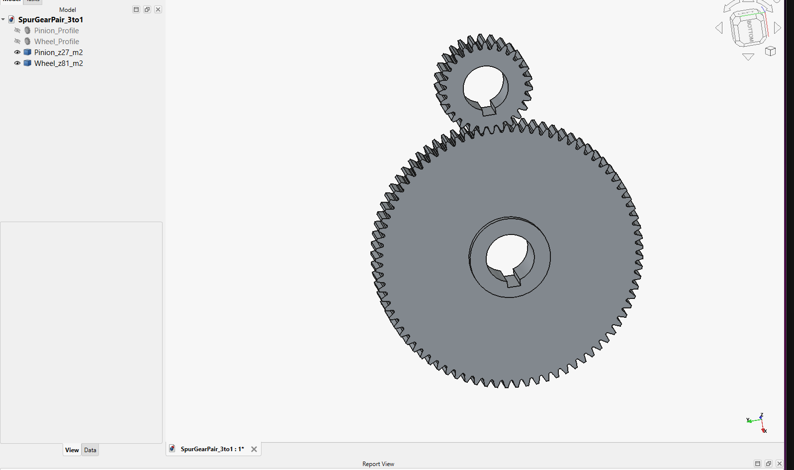
*A 3:1 spur gear pair (module 2, 27/81 teeth) built from a single plain-English brief, then FEA-checked in ANSYS.*

> **Source code:** the full source (MCP server, FreeCAD bridge, knowledge base and build scripts) is in a private repository and is **available on request**. See [Contact](#contact).

---

## What it does

- **Plain English → real CAD.** You give a brief ("3 kW motor, 3:1 reduction, case-hardened steel, keep it compact") and get a valid, parametric FreeCAD model back.
- **Asks before it assumes.** If a critical value is missing (bore size, load, material, process), it stops and asks short, specific questions instead of inventing numbers.
- **Runs the engineering first.** Expert rule files for each domain make it do the sizing calculations *before* it picks dimensions.
- **Checks its own result.** It confirms the result is a valid solid and reports volume, mass, key dimensions and assumptions.
- **Gets better over time.** Every corrected design is saved as a worked example that later requests reuse.

### Engineering domains covered

| Domain | What the assistant knows |
|---|---|
| ⚙️ **Gears & power transmission** | Spur, helical, bevel, worm and planetary gears; module selection, contact ratio, Lewis bending, steel under the tooth root vs. bore + keyway |
| 🚤 **Boat building for large-scale 3D printing (LSAM)** | Displacement and buoyancy, stability, print orientation, 45° overhang rule, bead-based wall thickness |
| 🔩 **Sheet metal** | Bend radii, K-factor, flanges, flat patterns, laser-cut / press-brake rules |
| 🏗️ **Weldments** | RHS/SHS/CHS, IPE/HEA/HEB profiles, gussets, welded frames |

---

## How it works

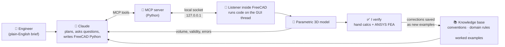

**Two Python parts, because FreeCAD has its own private Python interpreter:**

1. **The MCP server** is the process Claude launches. It exposes tools such as `ping_freecad`, `run_freecad_code`, `create_box`, `create_cylinder` and `get_document_info`.
2. **The listener** runs *inside* FreeCAD. It receives code over a localhost-only socket and executes it safely on FreeCAD's main GUI thread.

**The "intelligence" lives in a knowledge layer, not in a trained model.** The AI model itself never changes. Instead it reads a structured knowledge base every time: general CAD conventions (ISO clearance holes, edge distances, fillet limits), one expert file per engineering domain, and a library of solved, verified examples. This approach is transparent, version-controlled and works today.

### A design detail I'm proud of

FreeCAD's GUI is single-threaded, so running geometry code from a network thread crashes it. The listener hands each job from the socket thread to the main thread through a queue and a Qt timer:

```python
# Network thread only RECEIVES code; the GUI thread RUNS it.
_job_queue = queue.Queue()

def _drain_jobs():                      # called every 50 ms on FreeCAD's main thread
    while not _job_queue.empty():
        code, holder, done = _job_queue.get_nowait()
        try:
            env = {}
            exec(code, globals(), env)
            holder.update(ok=True, result=str(env.get("result", "executed")))
        except Exception:
            holder.update(ok=False, result=traceback.format_exc())  # real error goes back to the AI
        finally:
            done.set()

_timer = QtCore.QTimer()
_timer.setParent(Gui.getMainWindow())   # keeps the timer alive after the macro ends
_timer.timeout.connect(_drain_jobs)
_timer.start(50)
```

*(Shortened excerpt. The full implementation is in the private repository.)*

---

## Case study 1: Spur gear pair, verified with FEA

**The brief I typed:**
> *Design a spur gear pair and build it in FreeCAD. An electric motor delivers 3 kW at 1450 rpm into the pinion, I need a 3:1 reduction, it runs most of the day driving a conveyor with light shock, case-hardened steel. Size it properly, check the teeth will not fail, and keep it reasonably compact.*

**It asked before it built.** It worked out everything it could, then asked about the shaft mounting, the centre distance and the required life:

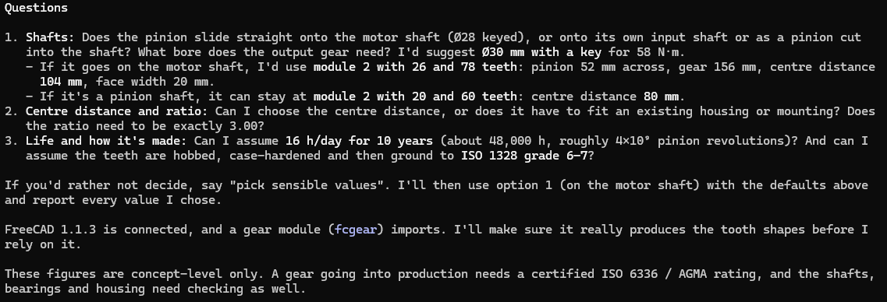

**It caught a real design problem.** With a Ø28 bore and an 8 mm keyway, 26 teeth would leave only 6.2 mm of steel under the tooth roots (the minimum is 7 mm). So it moved to **27/81 teeth**, which is still exactly 3.00:1. The bore, not the tooth strength, set the pinion size.

| Result | Pinion | Gear |
|---|---|---|
| Teeth | 27 | 81 |
| Module / pressure angle | 2 / 20° | 2 / 20° |
| Pitch diameter | 54 mm | 162 mm |
| Centre distance | 108 mm | |
| Contact ratio | 1.73 (target ≥ 1.4) | |
| Output | 483 rpm, 58.1 N·m | |

The gears are **live, editable FCGear objects**, so you can double-click to change the teeth or module later:

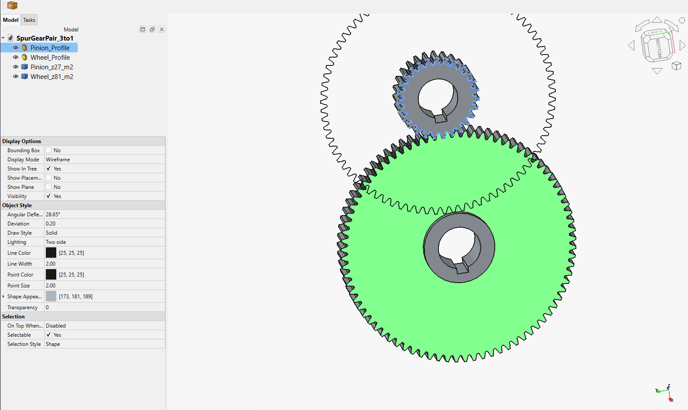

**My independent check in ANSYS Mechanical.** The gear was fixed at the bore and the full 732 N tooth force was applied near the tip of one tooth (the worst case for bending), with the mesh refined at the root.

| Tooth root stress | Value |
|---|---|
| AI estimate (Lewis, before factors) | ~52 MPa |
| AI estimate (with safety factors) | ~96 MPa |
| **My ANSYS FEA** | **33.8 MPa** |
| Material limit (16MnCr5) | ~430 MPa |

<p float="left">
  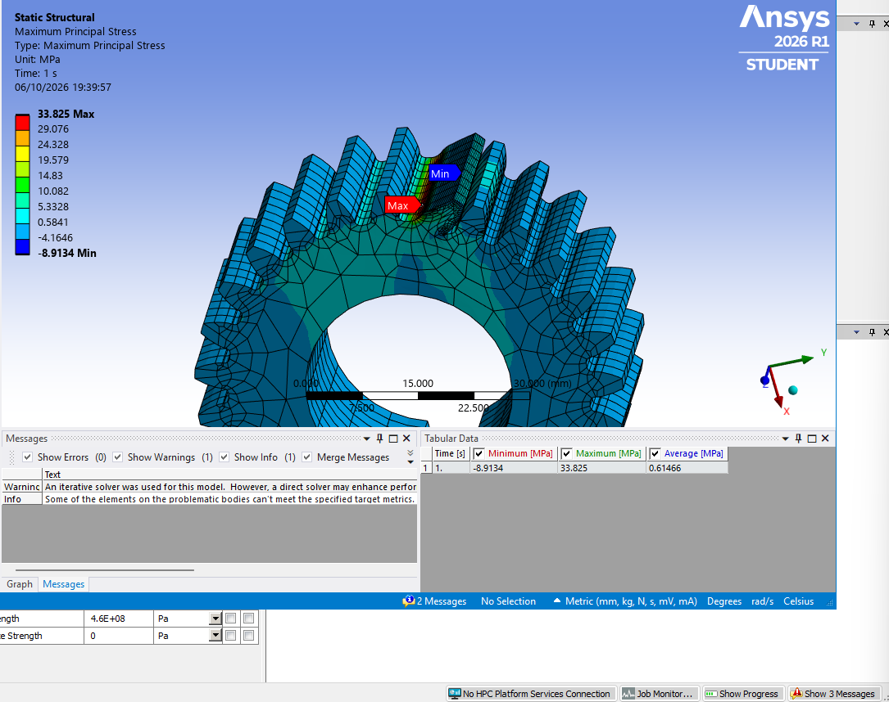
  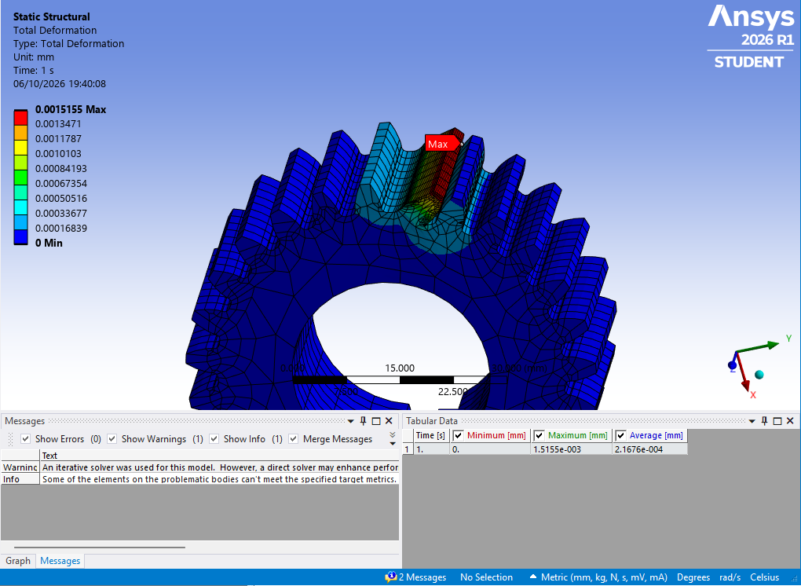
</p>

✅ **The strength claim is confirmed from two directions, with a very large margin.** Tip deflection is about 0.0015 mm.

📄 **Full report:** [Gear_Study_Report.pdf](reports/Gear_Study_Report.pdf)

---

## Case study 2: An innovative 3D-printed boat, verified

**The brief:** *"Build a boat. It has to be unique and innovative."* After its questions, I added the constraints: 2–2.2 m long, large-scale 3D printed **standing upright** in PETG, a 6 mm nozzle with 12 mm walls, no overhangs steeper than 45°, two people (150 kg) plus a 30 kg outboard, on a lake at 4–6 knots.

**What the assistant designed: "Chevron".** It spotted that printing upright creates two real problems and turned both into features:

- **Layer weakness along the length** → full-length channels for **tensioned steel tendons** that squeeze the printed layers together.
- **Flat crosswise surfaces become unprintable overhangs** → every crosswise face is set at exactly 45°, and the seat boxes double as **sealed buoyancy tanks**.

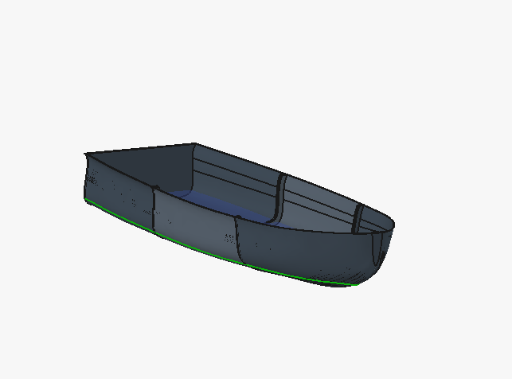

| Result | Value |
|---|---|
| Length × beam × depth | 2200 × 1283 × 601 mm |
| Hull mass | ~94 kg PETG |
| Loaded weight | ~274 kg |
| Draft | 211 mm |
| Print | single job, standing on the transom, no supports |

**I checked the three claims that can actually be checked:**

| Check | Method | Result |
|---|---|---|
| Does it float? | Measured underwater volume at the waterline | 275 kg of buoyancy vs. 274 kg loaded, **within 0.5 %** ✅ |
| Is it stable? | Waterplane property calculated two independent ways | The two methods agree **within 1.6 %**, with a large stability margin ✅ |
| Is the motor mount strong enough? | ANSYS static structural, PETG, cockpit floor held, motor loads at the transom | Peak stress **0.17 MPa**, deflection **0.2 mm** ✅ |

<p float="left">
  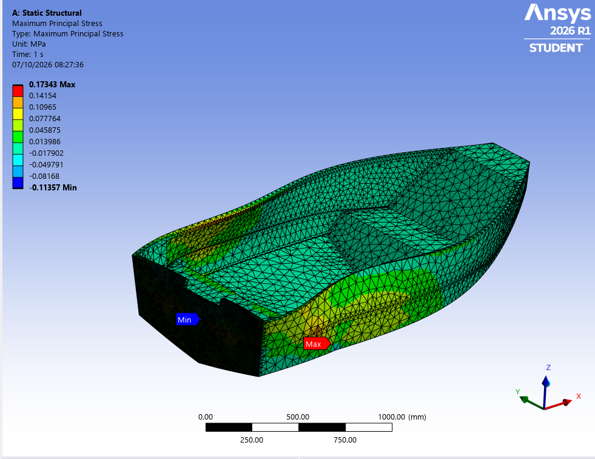
  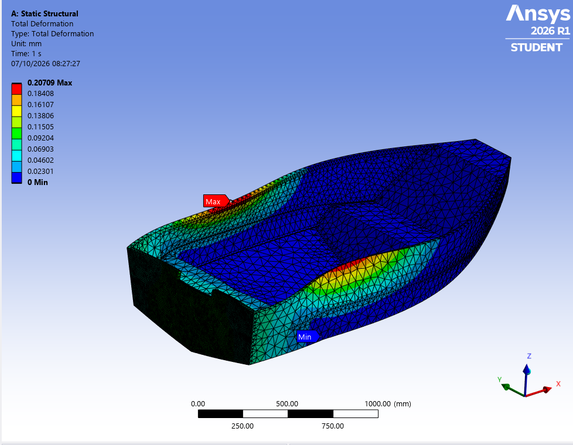
</p>

**What is *not* proven yet:** whether single-bead tank walls stay watertight, whether the tendons really stop the layers delaminating, and global hull bending in waves. These need a physical print and test. The right label for this design is *a checked concept, not a finished product*.

📄 **Full report:** [Boat_Study_Report.pdf](reports/Boat_Study_Report.pdf)

---

## More designs from the assistant

Concept hulls, each generated from a brief and checked in FreeCAD (buoyancy, stability, print rules):

| | | | |
|:---:|:---:|:---:|:---:|
| 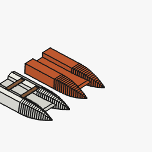 | 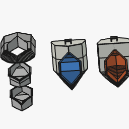 | 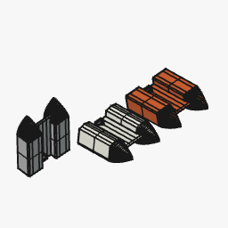 | 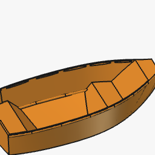 |
| **FlipCat**: a flip-over catamaran. One face is a stable 4-person pontoon, the other a faster 2-person V-sponson hull. | **SwapTub**: a flip *monohull*. One printed ring hull plus two swappable tubs for capacity or speed mode. | **MonoCat**: the reversible catamaran reworked as **one** large-format print. | **Chevron Dinghy**: an earlier, heavier version of the Chevron design. |

It also handles a **5.5 m LSAM displacement hull** for 4 people plus 300 kg. Here it flagged that 6 knots sits slightly above hull speed (Fn ≈ 0.44) and offered three engineering options instead of guessing:

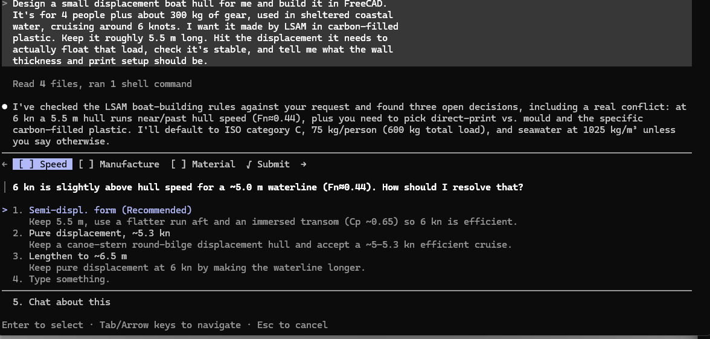

The FreeCAD models are in [`examples/`](examples/).

---

## What I learned

- **An AI is a fast, careful first pass, not the final sign-off.** It gets you to a real, checkable design quickly, and an engineer closes the loop with FEA and, for a product, a certified calculation (e.g. ISO 6336).
- **Knowledge beats prompting.** Writing the engineering rules down (what to ask, what to calculate, which limits to check) made the results far more reliable than clever prompts.
- **Honesty is a feature.** The assistant is built to say what is a concept, what is verified and what still needs testing.

## Tech stack

`Python` · `FreeCAD 1.1 (Part, FCGear)` · `Model Context Protocol (MCP)` · `Claude` · `ANSYS Mechanical` · `Socket IPC / Qt (PySide)`

## Status & roadmap

- [x] Live bridge between Claude and FreeCAD (MCP server + in-FreeCAD listener)
- [x] Knowledge base: conventions, 4 expert domains, worked examples, "ask before assuming" rule
- [x] Verified case studies: gears (FEA) and boats (hydrostatics + FEA)
- [ ] A `save_example` tool so corrected parts feed back in automatically
- [ ] 2D drawing → 3D reconstruction
- [ ] Sketcher / PartDesign coverage, then a public open-source release

## Contact

**Bertwin Kurisinkal Shine**, M.Sc. Advanced Manufacturing Engineering, TU Chemnitz
Simulation (FEM/CFD) and CAD engineer.

- 🌐 Portfolio: [bertwinkurisinkalshine-portfolio.netlify.app](https://bertwinkurisinkalshine-portfolio.netlify.app)
- 💼 LinkedIn: https://www.linkedin.com/in/bertwin-kurisinkal-shine/
- ✉️ For access to the source code, contact me through the details on my CV or portfolio.

---
<sub>© 2026 Bertwin Kurisinkal Shine. All rights reserved. This repository is a project showcase; the models, images and reports may not be reused without permission.</sub>
