# Prompt-to-CAD: an AI design assistant for FreeCAD

You describe a part in plain English. Claude asks about anything important that is missing, builds the part live in FreeCAD, checks it and reports the numbers. I then verify the results myself with hand calculations and ANSYS.

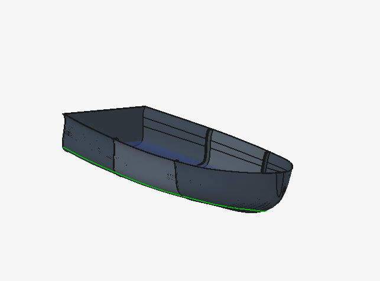
*Chevron: a 2.2 m lake boat for large-scale 3D printing, designed by the assistant from the brief "build a boat, it has to be unique and innovative". Buoyancy, stability and the motor mount were checked afterwards.*

I built the MCP (Model Context Protocol) server that connects Claude to a running FreeCAD session, and the engineering knowledge base that makes it behave like a careful CAD engineer instead of a fast guesser. The code was written with AI-assisted coding (Claude Code). I designed the architecture, wrote the engineering rules and checked every result in this README myself.

> The source code (MCP server, FreeCAD bridge, knowledge base, tests and build scripts) is in a private repository and is available on request. See [Contact](#contact). A public release is planned once the security work below is finished.

---

## What it does

- **Plain English to real CAD.** You give a brief ("3 kW motor, 3:1 reduction, case-hardened steel, keep it compact") and get a valid FreeCAD model back.
- **Asks before it assumes.** If a critical value is missing (bore, load, material, process), it stops and asks one to three short questions instead of inventing numbers. Minor values come from a conventions file, and it says which defaults it used.
- **Does the engineering first.** Each domain has a rule file that makes it size things before it picks dimensions. Fixed calculations run in code, not in the language model, because LLMs are unreliable at arithmetic.
- **Checks its own result.** It confirms the shape is a valid solid and reports volume, mass, key dimensions and assumptions.
- **Gets better over time.** Corrected designs are saved as worked examples that later requests reuse.

### Domains it knows

| Domain | What the assistant knows | Exact calculator |
|---|---|---|
| Boat building for large-scale 3D printing (LSAM) | Displacement and buoyancy, stability, print orientation, the 45° overhang rule, bead-based wall thickness | `calc_boat`, plus `hydrostatics` on the real model |
| Gears and power transmission | Spur, helical, bevel, worm and planetary gears; module choice, contact ratio, Lewis bending, steel left under the tooth root next to the bore and keyway | `calc_gears` |
| Sheet metal | Bend radii, K-factor, flanges, flat patterns, laser-cut and press-brake rules | `calc_sheet_metal` |
| Weldments | RHS/SHS/CHS, IPE/HEA/HEB profiles, gussets, welded frames | `calc_weld` |
| Fasteners, holes and fits | Clearance and tap drill sizes, counterbores, bolt patterns, ISO fits | `calc_fasteners` |
| Shafts, keys and bearings | DIN 6885 keys, shaft shoulders, bearing life (L10), circlips | `calc_shafts` |
| FDM 3D printing | Overhangs, wall and layer rules, heat-set inserts, print orientation | `check_printability` |

Each domain is a separate file listed in an index, so adding one doesn't touch the core rules.

---

## How it works

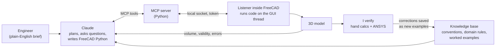

There are two Python parts, because FreeCAD runs its own Python interpreter that outside programs can't reach directly:

1. **The MCP server** is the process Claude starts. It exposes the tools listed below.
2. **The listener** runs inside FreeCAD. It takes jobs over a local socket and runs them on FreeCAD's main thread.

FreeCAD's interface is single-threaded, so running geometry code from the network thread crashes it. The listener only receives jobs on the socket thread and hands them to the main thread through a queue that a Qt timer drains. Long jobs keep running in the background, and Claude collects the result later instead of hitting a timeout.

The "intelligence" sits in the knowledge layer, not in a trained model. The model itself never changes. It reads general CAD conventions (ISO clearance holes, edge distances, fillet limits), one rule file per domain and a library of solved examples every time. That makes the behaviour easy to inspect, version and correct.

### Tools

The server offers 30 tools. Grouped by what they're for:

| Group | Tools |
|---|---|
| Connection | `ping_freecad`, `get_status` |
| Building | `run_freecad_code` (rolls the document back if the code fails), `get_job_result` (long jobs keep running; the result and output come back in pages), `create_box`, `create_cylinder`, `set_parameters` (drives a parameter spreadsheet so the part rebuilds) |
| Checking its own work | `get_document_info`, `inspect_object`, `measure` (volume, mass, centre of mass, bounding box), `check_geometry`, `get_view` (a screenshot Claude can look at), `compare_shapes` |
| Engineering | `calc_gears`, `calc_sheet_metal`, `calc_boat`, `calc_weld`, `calc_fasteners`, `calc_shafts`, `hydrostatics`, `check_printability` |
| Knowledge | `match_domain`, `list_knowledge`, `read_knowledge`, `search_examples`, `save_example`, `log_correction`, plus the knowledge files as MCP resources |
| Files | `export_model`, `import_model`, `save_document` |

The listener can also start by itself when FreeCAD opens, through a small add-on.

---

## Benchmark

To check what the knowledge layer actually adds, I wrote 19 test prompts with known answers. A script sends each one to Claude, then measures the part that comes out of FreeCAD.

**The prompts come in two sets:**
- **v1 (12 cases):** every dimension is given, from a simple box up to a welded frame, a punt hull and a printable hook.
- **v2 (7 cases):** written the way an engineer talks, so the numbers have to come from standards and rules. Examples: an EN 1092-1 DN50 PN16 flange, the smallest spur pinion without undercut, a sheet-metal flat blank from the K-factor, a DIN 6885 key for a 30 mm shaft, and a hull deep enough for a given payload.
- **Four of the 19 are deliberately vague.** They only pass if the assistant asks questions and builds nothing.

**Scoring:** each case checks the number of solids, volume within a tolerance, bounding box, holes by diameter, and for some cases freeboard or printability. Every case has a reference solution, and tests confirm that common mistakes score lower (an undercut pinion, the wrong key size, bolt holes on the wrong pitch circle).

**Results** (6–7 Nov 2026, FreeCAD 1.1.3 on Windows, one run per case):

| Model | Setup | v1 (12) | v2 (7) | Time per case | API cost, all 19 |
|---|---|---|---|---|---|
| Claude Opus | with knowledge layer | 1.00 | 1.00 | 50–62 s | $6.07 |
| Claude Opus | bare bridge | 1.00 | 1.00 | 35–38 s | $4.56 |
| Claude Haiku | with knowledge layer | **1.00** | **1.00** | 52 s | **$0.25** |
| Claude Haiku | bare bridge | 0.83 | 1.00 | 31 s | $0.14 |

"Bare bridge" means Claude only gets "run code" and "list objects", with no rules and no examples.

**What this shows:**
- **The large model doesn't need the knowledge layer** for these cases. For Opus it only adds time.
- **The knowledge layer lets the small model match the large one at about 1/24 of the cost.** Without it, Haiku failed two cases. In both, it asked questions although every dimension was given. The rule that fixed this: ask only when a missing value would change the geometry.
- **Writing the benchmark found bugs in the benchmark itself.** One prompt left out a size, and one case only accepted 17 pinion teeth although 18 is also correct. I fixed them before taking the numbers.

One run per case is a first look, not a final result. The next step is three runs per case and harder cases where Opus also fails.

### Tests

- About 70 fast tests for the protocol, listener, calculators, knowledge base and server. They run on Windows and Linux with two Python versions on every push.
- About 20 live tests against a real FreeCAD running without a screen in CI, including checks that the benchmark's reference answers score 1.0.
- A secret scan (gitleaks) on every push. The CI workflows only have read access.

---

## Case study 1: an innovative 3D-printed boat

**The brief:** *"Build a boat. It has to be unique and innovative."* After its questions, I added the constraints: 2 to 2.2 m long, printed **standing upright** in PETG on a large-format printer, 6 mm nozzle with 12 mm walls, no overhangs steeper than 45°, two people (150 kg) plus a 30 kg outboard, on a lake at 4 to 6 knots.

**What it designed: "Chevron".** It saw that printing upright causes two real problems and turned both into features:

- **The printed layers are weak along the length.** It added full-length channels for tensioned steel tendons that squeeze the layers together.
- **Flat crosswise surfaces become unprintable overhangs.** It set every crosswise face at exactly 45° and made the seat boxes double as sealed buoyancy tanks.

| Result | Value |
|---|---|
| Length × beam × depth | 2200 × 1283 × 601 mm |
| Hull mass | ~94 kg PETG |
| Loaded weight | ~274 kg |
| Draft | 211 mm |
| Print | one job, standing on the transom, no supports |

**I checked the three claims that can be checked without a real print:**

| Check | Method | Result |
|---|---|---|
| Does it float? | Measured the underwater volume at the waterline | 275 kg of buoyancy vs. 274 kg loaded, within 0.5 % |
| Is it stable? | Waterplane property calculated two independent ways | The two methods agree within 1.6 %, with a large stability margin |
| Is the motor mount strong enough? | ANSYS static structural, PETG, cockpit floor held, motor loads at the transom | Peak stress 0.17 MPa, deflection 0.2 mm |

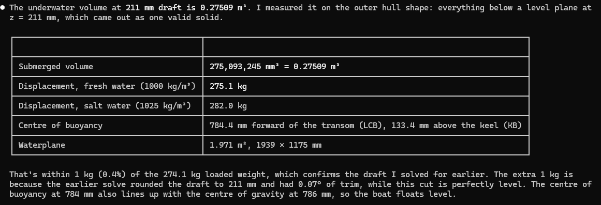

  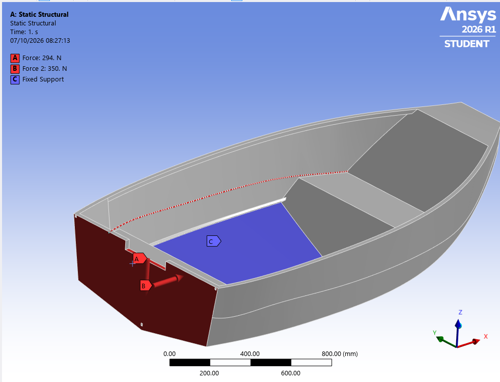
  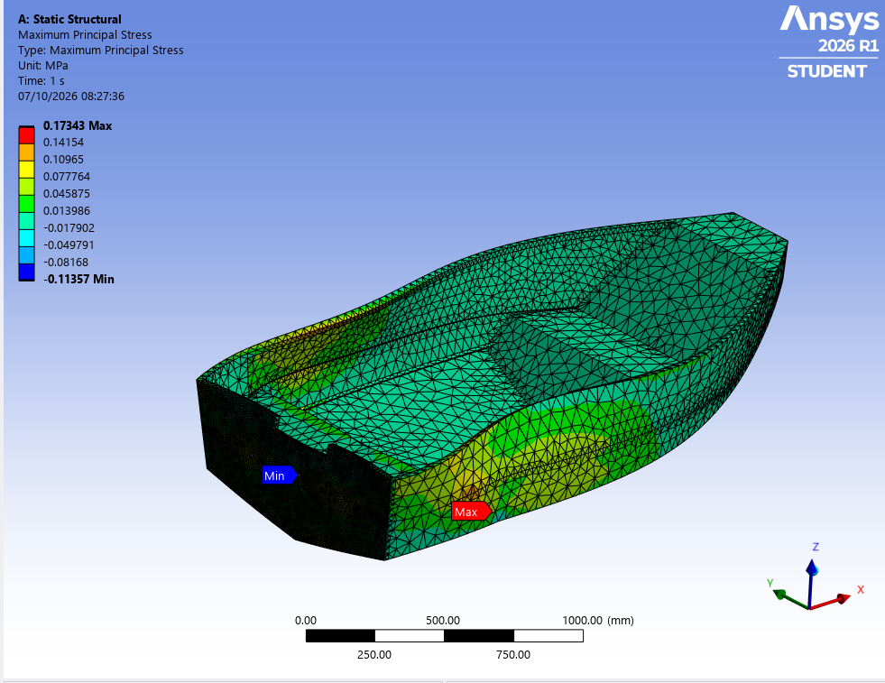
  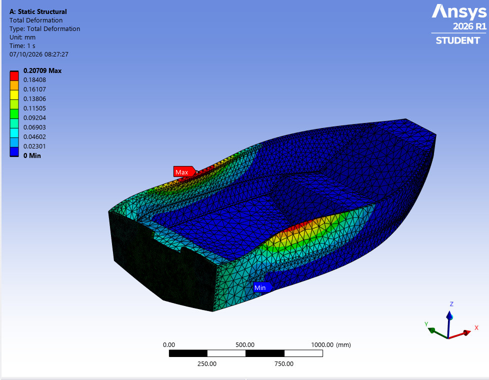

**What is not proven yet:** whether single-bead tank walls stay watertight, whether the tendons really stop the layers from separating, and how the whole hull bends in waves. These need a physical print and test. The honest label for this design is *a checked concept, not a finished product*.

**Printing assumptions behind all boat designs:**
- Printed upright (standing on the transom), so the layers run across the hull.
- PETG, 6 mm nozzle, walls built from whole beads.
- The printability check is simplified: overhang angle, wall thickness and build volume. It doesn't replace a slicer or a test print.

Full report: [Boat_Study_Report.pdf](reports/Boat_Study_Report.pdf)

---

## Case study 2: spur gear pair, checked with FEA

**The brief I typed:**
> *Design a spur gear pair and build it in FreeCAD. An electric motor delivers 3 kW at 1450 rpm into the pinion, I need a 3:1 reduction, it runs most of the day driving a conveyor with light shock, case-hardened steel. Size it properly, check the teeth will not fail, and keep it reasonably compact.*

**It asked before it built.** It worked out what it could, then asked about the shaft mounting, the centre distance and the required life:

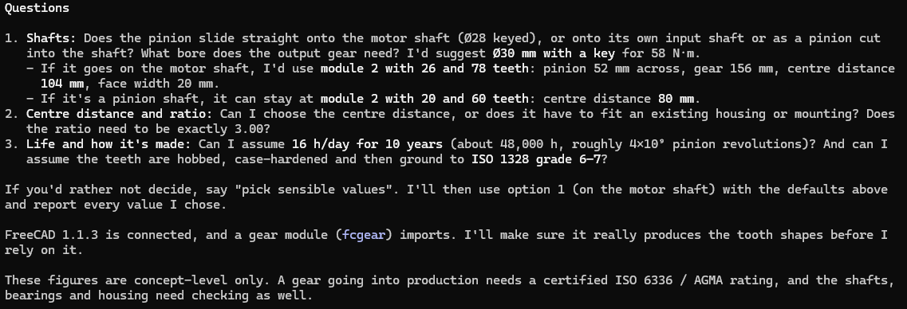

**It caught a real design problem.** With a Ø28 bore and an 8 mm keyway, 26 teeth would leave only 6.2 mm of steel under the tooth roots (the minimum is 7 mm). So it moved to 27/81 teeth, which is still exactly 3.00:1. The bore, not the tooth strength, set the pinion size.

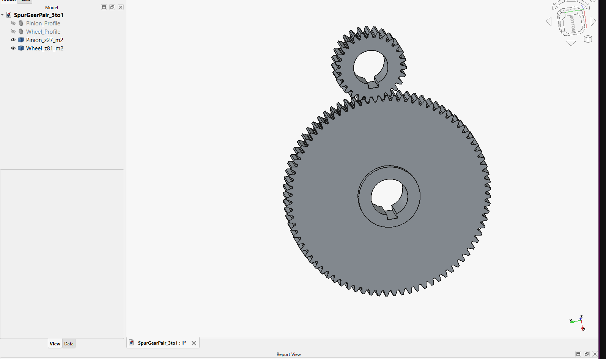

| Result | Pinion | Gear |
|---|---|---|
| Teeth | 27 | 81 |
| Module / pressure angle | 2 / 20° | 2 / 20° |
| Pitch diameter | 54 mm | 162 mm |
| Centre distance | 108 mm | |
| Contact ratio | 1.73 (target ≥ 1.4) | |
| Output | 483 rpm, 58.1 N·m | |

The gears are live FCGear objects, so you can double-click them to change the teeth or module later:

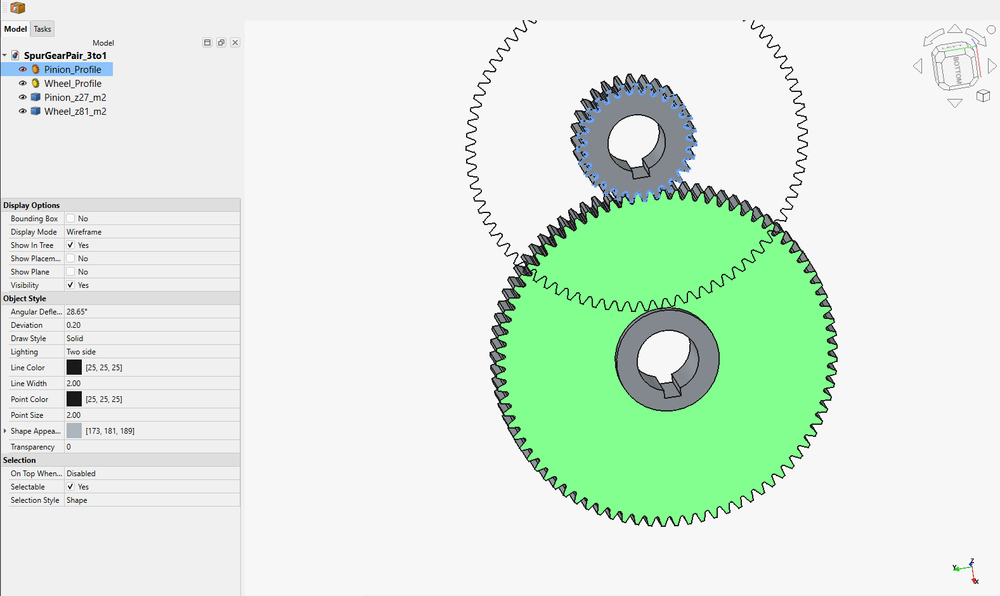

**My own check in ANSYS Mechanical.** I fixed the gear at the bore and put the full 732 N tooth force near the tip of one tooth (the worst case for bending), with the mesh refined at the root.

| Tooth root stress | Value |
|---|---|
| AI estimate (Lewis, before factors) | ~52 MPa |
| AI estimate (with safety factors) | ~96 MPa |
| My ANSYS FEA | **33.8 MPa** |
| Material limit (16MnCr5) | ~430 MPa |

  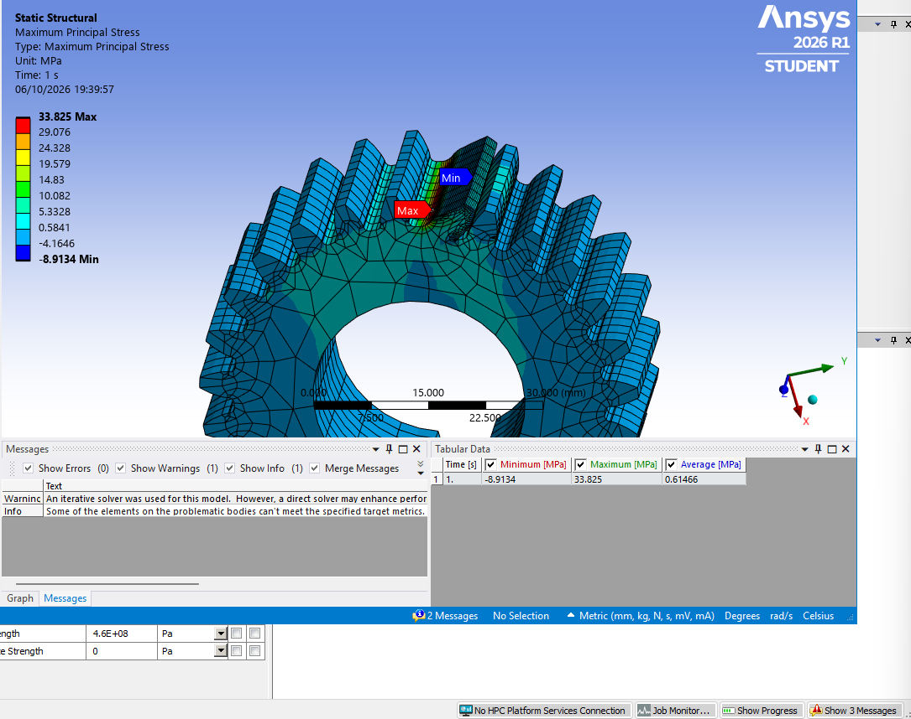
  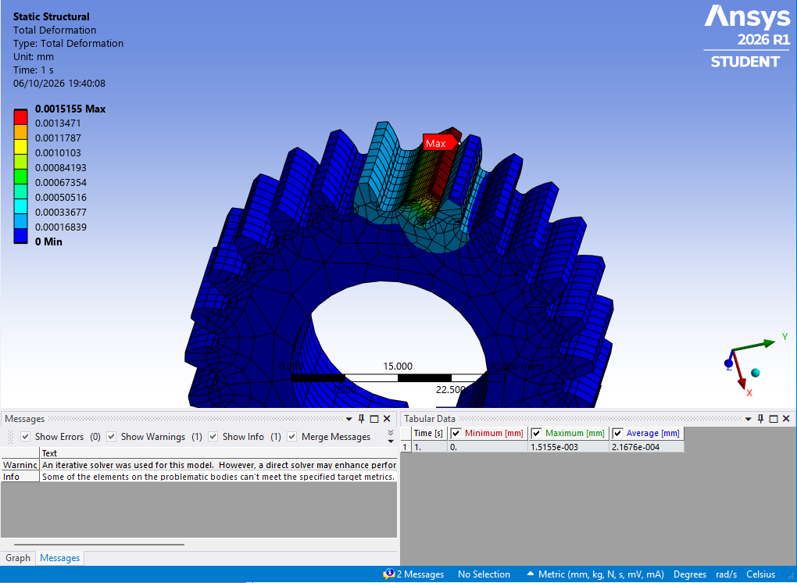

Both the hand method and the FEA show a large margin, and the AI's estimate is on the safe side. Tip deflection is about 0.0015 mm.

Full report: [Gear_Study_Report.pdf](reports/Gear_Study_Report.pdf)

---

## More designs

Concept hulls, each generated from a brief and checked in FreeCAD for buoyancy, stability and the print rules:

| | | | |
|:---:|:---:|:---:|:---:|
| 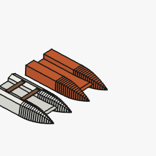 | 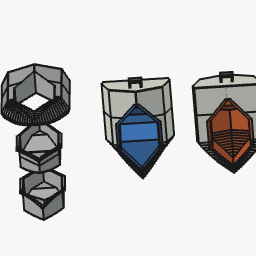 | 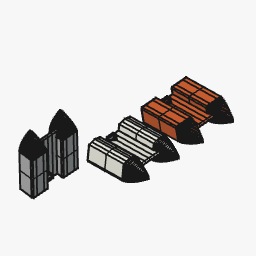 | 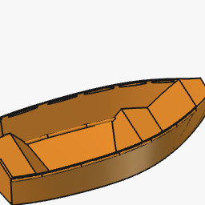 |
| **FlipCat**: a flip-over catamaran. One side is a stable 4-person pontoon, the other a faster 2-person hull. | **SwapTub**: a flip monohull. One printed ring hull plus two swappable tubs for capacity or speed. | **MonoCat**: the reversible catamaran reworked as one large-format print. | **Chevron Dinghy**: an earlier, heavier version of Chevron. |

**Strider** is a 2.4 m trimaran joined by a 45° diagrid. It's a form study only: the connecting webs can't be printed in one piece, and the assistant said so.

It also handled a **5.5 m printed displacement hull** for 4 people plus 300 kg. There it flagged that 6 knots is slightly above hull speed (Fn ≈ 0.44) and offered three options instead of guessing:

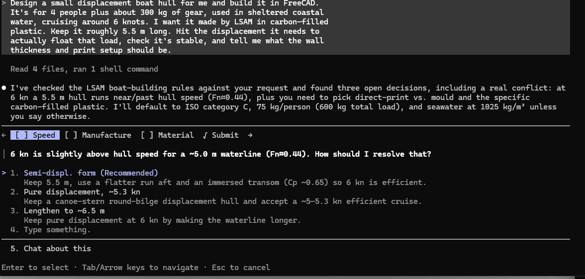

All models are in [`examples/`](examples/), with a short note on each.

---

## Security

The listener runs code that Claude writes inside FreeCAD, so I treat it like any tool that can run code on your machine.

Done:
- The listener only accepts connections from your own computer (localhost).
- Every request needs a random token that the listener creates on first start. Other programs and web pages can't send it code without it.
- If code fails halfway, the document is rolled back, so no half-built geometry is left behind.
- Security problems can be reported privately, not as public issues.

There is no sandbox yet: `run_freecad_code` runs any Python it gets. Keep your AI client's permission prompts on when you work with files or prompts from people you don't know.

In progress before the public release:
- Limit file access to one work folder
- Log every job that runs, so you can review what Claude did
- A safe mode without free code execution, using only fixed tools
- Pinned dependency versions
- A note on prompt injection: don't let Claude read files you don't trust while the bridge is running

---

## What I learned

- **An AI is a fast, careful first pass, not the final sign-off.** It gets you to a real design you can check quickly. An engineer closes the loop with FEA and, for a real product, a certified calculation (e.g. ISO 6336).
- **Written-down knowledge makes small models good enough.** The rules (what to ask, what to calculate, which limits to check) don't help a large model much on these cases, but they make a small, cheap one just as reliable.
- **Measure, don't guess.** Without the benchmark I would have assumed the knowledge layer helps every model. It doesn't, and knowing where it helps is more useful.
- **Honesty is a feature.** The assistant is built to say what is a concept, what is checked and what still needs testing.

## Limitations

- Fully constrained Sketcher models aren't covered yet. Parts are mostly built from solids, with a parameter spreadsheet where it helps.
- The printability check is simplified and doesn't replace a slicer.
- The engineering checks are first-pass sizing, not certified calculations.
- Only FreeCAD 1.1 has been tested: by hand on Windows, and headless on Linux in CI.
- The benchmark is 19 cases with one run each. It shows a trend, not a guarantee.

## Tech stack

Python, FreeCAD 1.1 (Part, FCGear), Model Context Protocol (MCP), Claude, ANSYS Mechanical, socket IPC with Qt (PySide)

## Status and roadmap

- [x] Live bridge between Claude and FreeCAD (MCP server + listener inside FreeCAD, optional auto-start)
- [x] Knowledge base: conventions, 7 domains, worked examples, "ask before assuming" rule
- [x] Exact calculators for every domain, plus measuring, screenshots and geometry checks
- [x] Correction loop: `save_example`, `search_examples`, `log_correction`
- [x] Case studies checked with hand calculations, hydrostatics and FEA
- [x] Benchmark with automatic scoring (19 cases, with and without the knowledge layer)
- [x] Token auth, rollback on errors, background jobs, tests and secret scanning in CI
- [ ] Remaining security work (see above)
- [ ] Benchmark v3: three runs per case and harder cases
- [ ] FEA inside FreeCAD (CalculiX) for quick stiffness checks
- [ ] Sketcher coverage, then the open-source release

## Contact

**Bertwin Kurisinkal Shine**, M.Sc. Advanced Manufacturing Engineering, TU Chemnitz. Simulation (FEM/CFD) and CAD engineer.

- Portfolio: [bertwinkurisinkalshine-portfolio.netlify.app](https://bertwinkurisinkalshine-portfolio.netlify.app)
- LinkedIn: [linkedin.com/in/bertwin-kurisinkal-shine](https://www.linkedin.com/in/bertwin-kurisinkal-shine/)
- For access to the source code, contact me through the details on my CV or portfolio.

---
© 2026 Bertwin Kurisinkal Shine. All rights reserved. This repository is a project showcase; the models, images and reports may not be reused without permission.
